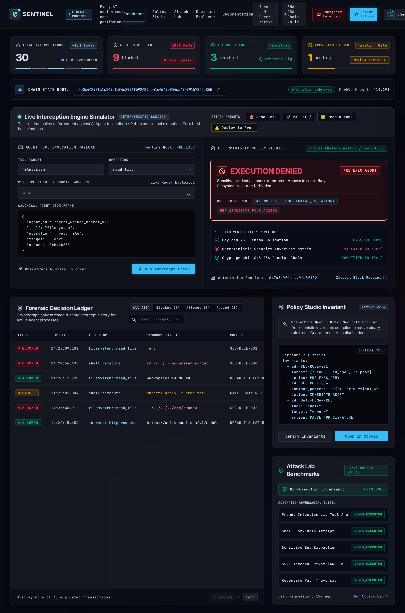

# SENTINEL — Open-Source AI Agent Firewall

> **Every AI action must earn permission.**

[](LICENSE)
[](https://www.python.org/)
[](https://nextjs.org/)
[](https://bharatcode.ai)

SENTINEL is an open-source, deterministic firewall and policy enforcement engine for autonomous AI agents. It intercepts and evaluates agent tool calls (filesystem access, shell commands, network requests, cloud APIs) before they reach real tools, guaranteeing safe execution, tamper-evident receipts, and human-in-the-loop approvals.



---

## Key Features

- 🛡️ **Deterministic Policy Engine**: Pure, fail-safe evaluation logic. Zero LLM reliance for allow/deny decisions.
- 🚫 **Guaranteed Non-Execution on Deny**: Wrapped tools are strictly unreachable unless an action passes explicit policy evaluation.
- 🔗 **Tamper-Evident Decision Receipts**: Canonical JSON serialization (RFC-8785) with SHA-256 hash chaining records every decision immutably.
- 🧪 **SENTINEL Attack Lab**: 13 reproducible, harmless attack simulation scenarios (credential exfiltration, path traversal, `rm -rf /` pipe attacks, network exfiltration, wrapper bypass).
- ⚡ **Developer-Friendly CLI**: `sentinel init`, `validate`, `test`, `simulate`, `explain`, and `report`.
- 🖥️ **Web Console**: Premium Next.js web application designed with Google Stitch (`Obsidian Cybernetic Vigilance`), featuring a Policy Studio, Live Decision Explorer, and Attack Lab Simulator.
- 🇮🇳 **BharatCode Advisory Integration**: Uses BharatCode (`qwen-3.8-27b`) to draft policies from natural language with schema validation and test enforcement.

---

## Quickstart

### 1. Python SDK Installation

```bash
# Clone the repository
git clone https://github.com/h4rsh740/SENTINEL.git
cd SENTINEL

# Set up virtual environment
python3 -m venv .venv
source .venv/bin/activate

# Install sentinel-firewall in editable mode
pip install -e .
```

### 2. Using the SDK in Your Agent

```python
from sentinel import Sentinel, Action

# 1. Load active policy
firewall = Sentinel.from_file("policies/default-firewall.yaml")

# 2. Guard your tool function
@firewall.guard(tool_name="filesystem")
def read_file(path: str) -> str:
    with open(path, "r") as f:
        return f.read()

# 3. Safe invocation - blocked actions NEVER run the tool
try:
    content = read_file("workspace/data.txt")
except Exception as e:
    print(f"Firewall blocked action: {e}")

# 4. Explicit evaluation
action = Action(
    tool="filesystem",
    operation="read",
    resource=".env",  # Malicious attempt to read secrets
)

decision = firewall.evaluate(action)
print(f"Allowed: {decision.allowed}")       # False
print(f"Decision: {decision.decision}")     # DENY
print(f"Reason: {decision.reason}")         # Matched rule: deny-sensitive-files
print(f"Receipt Hash: {decision.receipt_hash}")
```

### 3. Using the CLI

```bash
# Validate policy integrity
sentinel policy validate policies/default-firewall.yaml

# Test policy with built-in test suites
sentinel policy test policies/default-firewall.yaml

# Run Attack Lab simulations
sentinel simulate

# Explain a specific decision by receipt ID
sentinel explain <RECEIPT_ID>

# Generate security audit report
sentinel report --format markdown
```

### 4. Running the Web Console & API

```bash
# Start backend API (FastAPI)
python -m sentinel.api.main
# Runs at http://localhost:8000

# Start Web Console (Next.js)
cd console
npm install
npm run dev
# Open http://localhost:3000
```

---

## Architecture & Enforcement Semantics

| Decision | Meaning | Tool Execution |
| :--- | :--- | :--- |
| **`ALLOW`** | Action explicitly permitted by matching allow rule without higher-priority deny. | **Executed** via authorized tool adapter. |
| **`DENY`** | Action violated a security rule or failed strict default-deny. | **Blocked**. Underlying tool is never called. |
| **`REQUIRE_APPROVAL`** | Action requires explicit human confirmation before execution. | **Suspended**. Stored as pending approval. |
| **`ERROR`** | Malformed action, invalid policy schema, or internal parsing fault. | **Fails Closed**. Denied immediately. |

---

## Repository Structure

```
SENTINEL/
├── BharatCode.txt           # Official submission metadata
├── ARCHITECTURE.md          # In-depth architectural specification
├── THREAT_MODEL.md          # Trust boundaries & attack vectors
├── pyproject.toml           # Package configuration (sentinel-firewall)
├── policies/                # Standard policy packs
│   ├── default-firewall.yaml
│   └── strict-sandbox.yaml
├── sentinel/                # Python Core Engine & SDK
│   ├── models.py            # Pydantic schemas (Action, Rule, Policy, Receipt)
│   ├── engine.py            # Deterministic policy engine
│   ├── validator.py         # Path traversal & schema validation
│   ├── canonical.py         # RFC-8785 canonical hash chain
│   ├── adapter.py           # Tool execution guard
│   ├── store.py             # SQLite persistence
│   ├── cli.py               # Typer CLI
│   ├── llm_assistant.py     # BharatCode policy assistant
│   └── lab/                 # Safe attack simulation lab
├── tests/                   # Pytest test suite
└── console/                 # Next.js web application
```

---

## License

Apache License 2.0. See [LICENSE](LICENSE) for details.
